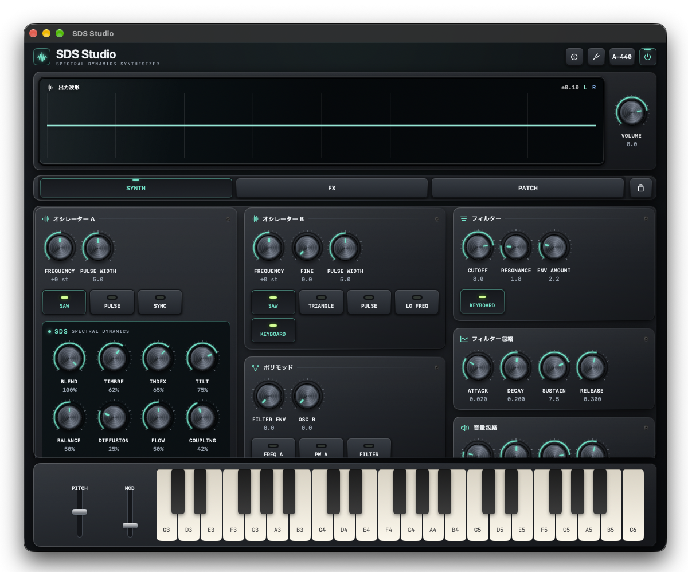

# SDS Studio



SDSのスペクトル合成をOSC Aに組み込んだ、macOS・iPhone・iPad向けのシンセサイザーです。Synthのボイス構造、演奏パネル、音色メモリー、エフェクトパッチ、MIDI、AUv3をベースにしています。UIの主要な操作は英語、日本語、简体中文で表示します。

## 起動

[Spectral.xcodeproj](Spectral.xcodeproj) をXcodeで開き、Macでは **Spectral-macOS**、iPhone・iPadでは **Spectral** を選んで実行します。実機ではアプリとAUv3の署名チームを設定してください。

ネイティブDSPはRustで、Xcodeのビルド時にコンパイルします。iOS向けターゲットは `rustup target add aarch64-apple-ios aarch64-apple-ios-sim`、Intel Mac向けは `rustup target add x86_64-apple-darwin` で追加できます。

## 音づくり

上部のディスプレイには、フィルター・エフェクト・マスター音量を通った左右チャンネルの実波形が表示されます。SYNTH・FX・PATCHの各画面から確認できます。

1. **OSCILLATOR A**の下部にある**SDS**ブロックで、**TIMBRE**ノブを上下にドラッグします。サイン、奇数倍音、ノコギリ、メタル、ブルームの間を連続的にモーフできます。
2. **BLEND**で従来波形とSDSを混ぜます。100%でOSC AはSDSのみです。SDSブロックの残りのノブで変調指数、スペクトル傾斜、側帯波バランス、拡散、移流、倍音結合、位相の揺らぎを調整します。ノブはダブルクリックまたはダブルタップで初期値に戻せます。
3. **Mixer**でOSC Bやノイズを重ねます。**Poly-Mod**ではOSC BやフィルターEGでOSC Aのピッチ、側帯波深度、フィルターを変調できます。OSC AのPWMルートは、従来波形に対してはパルス幅、SDSに対しては側帯波深度を変調します。
4. フィルターと音量のADSRを独立に調整し、**FX**と**Patch**でエフェクトを設定・接続します。

SDSは最大32個の倍音を個別の複素振幅として更新し、上下3次までの側帯波を重ねます。オシレーターのピッチと同期はSynthのボイス側が管理します。Rust側ではスロットごとにスペクトルの履歴を保持し、音量エンベロープと最終ミックスはSynthの経路で処理します。

プログラムとAUv3の状態にはSDSの設定も保存されます。AUv3ではアドレス300〜308がSDS用です。StudioのAUv3コンポーネントは `aumu / SDS2 / SpDy` です。従来の `SDS1` を参照するDAWプロジェクトではStudioインスタンスへの差し替えが必要です。

## 楽器プリセット

SYNTH・FX・PATCHのナビゲーション右端にある音符アイコンから、楽器プリセットを選べます。弦楽器、木管楽器、金管楽器、打楽器、鍵盤楽器に分かれています。音色はSDS Studioの合成パラメーターで作成しています。

## 検証

```sh
cargo test --release --offline --locked --manifest-path NativeEngine/Cargo.toml
cargo build --release --offline --locked --manifest-path NativeEngine/Cargo.toml
xcrun swiftc -O -import-objc-header NativeEngine/SpectralDSP.h \
  -L NativeEngine/target/release -lspectral_dsp \
  Studio/Sources/SynthApp/{ProphetCore,Rev3Parameters,EffectsGraph,EffectsDSP,MIDIInputState,HostedSynthAudioUnit,SpectralOscillator,OutputScope}.swift \
  Studio/Tests/SpectralIntegration.swift -o /tmp/sds-studio-integration
/tmp/sds-studio-integration
```
